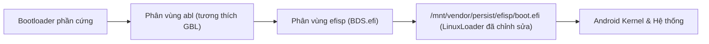

# Fake BL EFISP (with Automatic HWC Global Patch)

Module dành cho **KernelSU / KSU Next / APatch** trên các thiết bị dùng nền tảng Qualcomm Snapdragon 8 Elite / 8 Gen 5 (Xiaomi & OnePlus / OPPO), hỗ trợ thiết lập chuỗi nạp khởi động trung gian qua phân vùng `efisp` và tự động đồng bộ bootloader kèm cấu hình `androidboot.hwc=global` qua các bản cập nhật OTA.

---

## 1. Cấu trúc thành phần của Module

```text
fake_bl_efisp/
├── BDS.efi                 # Trình nạp khởi động UEFI trung gian (Boot Device Selection) ghi vào phân vùng efisp
├── customize.sh            # Script cài đặt tương tác bằng phím âm lượng (Vol+ / Vol-)
├── module.prop             # Thông tin định danh module
├── uninstall.sh            # Script dọn dẹp thư mục tạm khi gỡ module
├── ablrepo/                # Kho chứa ảnh abl.img và mã kiểm tra abl.sha256 theo từng mã thiết bị (ro.product.name)
├── bin/
│   ├── extractfv           # Công cụ tách Firmware Volume từ phân vùng abl để lấy LinuxLoader.efi
│   ├── patch_abl           # Công cụ xử lý nhị phân LinuxLoader.efi -> boot.efi
│   ├── patch_hwc           # Công cụ tự động gán tham số androidboot.hwc=global cho thiết bị Xiaomi
│   └── bl_flasher.sh       # Script xử lý đồng bộ slot A/B và cập nhật efisp sau khi OTA
├── efisp/
│   ├── BOOTENTRIES         # Cấu hình menu khởi động chính (boot.efi, boot_backup.efi, tools)
│   └── tools/              # Các tiện ích UEFI bổ trợ (RebootTools.efi, BLTools.efi, ArbTools.efi)
└── webroot/                # Giao diện điều khiển KernelSU WebUI (index.html, app.js, style.css)
```

---

## 2. Cơ chế chuỗi nạp khởi động (Chainloading)

Thay vì để phân vùng `abl` nạp thẳng hệ điều hành như mặc định, module thiết lập chuỗi nạp nối tiếp qua phân vùng `efisp` và `/mnt/vendor/persist/efisp`:



* **Tách biệt phiên bản `abl` và `boot.efi`**: Ngay cả khi phân vùng `abl` được hạ cấp xuống bản cũ để hỗ trợ nạp `BDS.efi` từ `efisp`, tệp `boot.efi` đặt tại `/mnt/vendor/persist/efisp/boot.efi` vẫn được trích xuất và xử lý từ **ABL của bản ROM hiện tại**, đảm bảo khả năng tương thích khi khởi động các bản cập nhật hệ thống mới.
* **Tự động xử lý HWC (`androidboot.hwc=global`)**:
  * **Trên thiết bị Xiaomi**: Sau khi `patch_abl` tạo ra `boot.efi`, công cụ `bin/patch_hwc` tự động quét và điều chỉnh tham số kernel command line thành `androidboot.hwc=global` (xuất ra `boot1.efi`, xóa `boot.efi` cũ và đổi tên `boot1.efi` thành `boot.efi`), giúp máy nội địa chạy ROM Global hoạt động ổn định.
  * **Trên thiết bị OnePlus / OPPO**: Khi không phát hiện trường `androidboot.hwc=`, `patch_hwc` tự động bỏ qua và giữ nguyên `boot.efi` để cài đặt bình thường.

---

## 3. Quy trình hoạt động chi tiết

### A. Giai đoạn cài đặt (`customize.sh`)

1. **Chọn ngôn ngữ**:
   * `Vol+`: Tiếng Trung (`zh`)
   * `Vol-`: Tiếng Anh (`en`)
2. **Chọn chế độ cài đặt**:
   * **Nhánh `Vol+` (Cài mới lần đầu)**:
     1. Nhận diện slot đang hoạt động (`_a` hoặc `_b`) qua `ro.boot.slot_suffix`.
     2. Chạy `extractfv` tách `LinuxLoader.efi` từ `/dev/block/by-name/abl_<slot>`.
     3. Chạy `patch_abl` tạo `boot.efi`, sau đó chạy `patch_hwc` để cập nhật `androidboot.hwc=global` (nếu là máy Xiaomi).
     4. Kiểm tra khả năng nạp `efisp` của `abl` hiện tại: nếu `abl` đang chạy chưa hỗ trợ, script hỏi xác nhận hạ cấp `abl` từ kho `ablrepo/<product>` (ưu tiên kiểm tra SHA-256 từ gói cục bộ trong module trước, nếu không khớp sẽ tải từ nhánh `main` trên GitHub).
     5. Sao lưu `boot.efi` cũ (nếu có) thành `boot_backup.efi`, chép `boot.efi` mới cùng cây thư mục menu `efisp/` vào `/mnt/vendor/persist/efisp/` và gọi `sync`.
     6. Ghi `BDS.efi` vào phân vùng `/dev/block/by-name/efisp` và gọi `sync`.
     7. Khi module cài đặt hoàn tất, bấm **Reboot**:
        * Ở lần khởi động lại đầu tiên, máy sẽ hiện ra menu **superfastboot**: di chuyển chọn **Android** và bấm nút **Nguồn**.
        * Màn hình sẽ báo `Booting Android` rồi tự động đẩy vào **Recovery** (do cần khởi tạo lại khóa mã hóa dữ liệu theo trạng thái mới).
        * Thực hiện **Format Data** ngay trong Recovery rồi **Reboot** là máy sẽ khởi động thẳng vào **System** (sau khi vào hệ thống và có lại KernelSU, cài lại module một lần nữa và chọn `Vol-` để lưu công cụ dùng khi OTA).
   * **Nhánh `Vol-` (Cập nhật module / Đã cài đặt từ trước)**:
     * Giải nén bộ công cụ `bin/` và giao diện `webroot/` vào `/data/adb/modules/fake_bl_efisp` để sử dụng sau mỗi lần cập nhật OTA.

### B. Giai đoạn duy trì sau khi cập nhật OTA (`bin/bl_flasher.sh` & WebUI)

Khi hệ thống Android tải và cài xong bản cập nhật OTA trên thiết bị A/B (chưa khởi động lại), hệ thống mới nằm ở **slot không hoạt động (`target_slot`)**. Trước khi bấm khởi động lại, người dùng mở **KernelSU WebUI** của module:

* **刷写到另一槽位 / Flash To Other Slot (`update-efisp`)**:
  1. Trích xuất `LinuxLoader.efi` từ phân vùng `abl` của **slot đích (`target_slot` — bản OTA mới)**.
  2. Chạy `patch_abl` và `patch_hwc` để tạo `boot.efi` mới tương ứng với bản OTA đó, cập nhật vào `/mnt/vendor/persist/efisp/boot.efi` (giữ bản trước đó làm `boot_backup.efi`) và làm mới `BDS.efi` trên phân vùng `efisp`.
  3. Kiểm tra phân vùng `abl` mới ở `target_slot`: nếu bản `abl` mới vẫn hỗ trợ nạp `efisp` thì giữ nguyên; nếu đã bị thay đổi trên bản OTA mới thì tự động sao chép phân vùng `abl` từ `current_slot` sang `target_slot` để giữ chuỗi khởi động khi máy chuyển slot.
* **仅更新BDS和Tools / Update BDS & Tools Only (`update-bds-tools`)**:
  * Chỉ ghi lại `BDS.efi` vào phân vùng `efisp` và cập nhật bộ menu `BOOTENTRIES` + `tools/` trong `/mnt/vendor/persist/efisp/`, không can thiệp vào `abl` hay `boot.efi`.
* **调试模式 / Debug Mode (`debug`)**:
  * Chạy thử toàn bộ quy trình trích xuất và xử lý `boot.efi` vào thư mục tạm `/data/adb/modules/fake_bl_efisp/tmp/efisp` để kiểm tra log mà không ghi vào phân vùng thật.

---

## 4. Danh sách mã thiết bị hỗ trợ trong `ablrepo/`

| Hãng | Mã `ro.product.name` trong `ablrepo/` |
| :--- | :--- |
| **Xiaomi** | `byron`, `myron`, `myron_eea`, `myron_global`, `nezha`, `nezha_global`, `pandora`, `popsicle`, `pudding`, `pudding_eea`, `pudding_global`, `songyuan`, `songyuan_eea`, `songyuan_global` |
| **OnePlus / OPPO** | `CPH2841`, `OPD2513`, `PLK110`, `PLR110`, `PLZ110`, `PMA120` |
