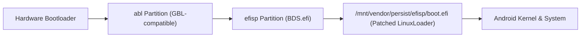

# Fake BL EFISP (with Automatic HWC Global Patch)

A **KernelSU / KSU Next / APatch** module for Qualcomm Snapdragon 8 Elite / 8 Gen 5 devices (Xiaomi & OnePlus / OPPO) that sets up an intermediate UEFI boot chain via the `efisp` partition and automatically synchronizes bootloader images along with the `androidboot.hwc=global` configuration across OTA updates.

---

## 1. Module Structure

```text
fake_bl_efisp/
├── BDS.efi                 # Intermediate UEFI boot manager (Boot Device Selection) flashed to the efisp partition
├── customize.sh            # Interactive installation script controlled via volume keys (Vol+ / Vol-)
├── module.prop             # Module metadata
├── uninstall.sh            # Cleanup script for temporary runtime files on uninstall
├── ablrepo/                # Bundled repository of older abl.img images and abl.sha256 checksums indexed by ro.product.name
├── bin/
│   ├── extractfv           # Extracts the Firmware Volume from the abl partition to obtain LinuxLoader.efi
│   ├── patch_abl           # Binary patcher that processes LinuxLoader.efi -> boot.efi
│   ├── patch_hwc           # Automatically sets androidboot.hwc=global on Xiaomi devices
│   └── bl_flasher.sh       # A/B slot synchronization and efisp update script for OTA updates
├── efisp/
│   ├── BOOTENTRIES         # Main boot menu configuration (boot.efi, boot_backup.efi, tools)
│   └── tools/              # Auxiliary UEFI utilities (RebootTools.efi, BLTools.efi, ArbTools.efi)
└── webroot/                # KernelSU WebUI dashboard (index.html, app.js, style.css)
```

---

## 2. Boot Chain Architecture (Chainloading)

Instead of having the `abl` partition boot the operating system directly, the module sets up a chainloaded boot sequence through the `efisp` partition and `/mnt/vendor/persist/efisp`:



* **Decoupled `abl` and `boot.efi` versions**: Even when the `abl` partition is downgraded to an older image capable of loading `BDS.efi` from `efisp`, the `/mnt/vendor/persist/efisp/boot.efi` image is always extracted and built from the **currently installed ROM's ABL**, ensuring full compatibility with newer system builds.
* **Automatic HWC Handling (`androidboot.hwc=global`)**:
  * **On Xiaomi devices**: Right after `patch_abl` produces `boot.efi`, `bin/patch_hwc` automatically locates and updates the hardware country command-line parameter to `androidboot.hwc=global` (generating `boot1.efi`, removing the unpatched `boot.efi`, and renaming `boot1.efi` to `boot.efi`), allowing Chinese domestic hardware to run Global ROMs seamlessly.
  * **On OnePlus / OPPO devices**: When no `androidboot.hwc=` entry is present in the image, `patch_hwc` automatically skips the HWC step and keeps `boot.efi` intact.

---

## 3. Detailed Workflow

### A. Installation Phase (`customize.sh`)

1. **Language Selection**:
   * `Vol+`: Chinese (`zh`)
   * `Vol-`: English (`en`)
2. **Installation Mode Selection**:
   * **`Vol+` Branch (First-time / Fresh Install)**:
     1. Detects the active slot (`_a` or `_b`) via `ro.boot.slot_suffix`.
     2. Runs `extractfv` to extract `LinuxLoader.efi` from `/dev/block/by-name/abl_<slot>`.
     3. Runs `patch_abl` to generate `boot.efi`, followed by `patch_hwc` to apply `androidboot.hwc=global` (on Xiaomi devices).
     4. Checks whether the current `abl` supports loading `efisp`: if not, prompts the user to downgrade `abl` using `ablrepo/<product>` (verifying SHA-256 against the local bundled image first, falling back to the GitHub `main` branch if needed).
     5. Backs up any existing `boot.efi` to `boot_backup.efi`, copies the newly generated `boot.efi` and the `efisp/` menu tree to `/mnt/vendor/persist/efisp/`, and runs `sync`.
     6. Flashes `BDS.efi` to `/dev/block/by-name/efisp` and runs `sync`.
     7. Once installation finishes, tap **Reboot**:
        * On the first reboot, the **superfastboot** menu will appear: select **Android** and press the **Power** button.
        * The device will display `Booting Android` and automatically enter **Recovery** (since data encryption keys must be re-initialized for the updated boot state).
        * Perform **Format Data** inside Recovery and **Reboot** — the device will boot straight into **System** (after booting into Android and restoring KernelSU, flash this module once more and select `Vol-` to keep the OTA maintenance tools installed).
   * **`Vol-` Branch (Module Update / Already Installed)**:
     * Installs the `bin/` utilities and `webroot/` interface into `/data/adb/modules/fake_bl_efisp` for post-OTA maintenance without modifying partitions immediately.

### B. Post-OTA Maintenance Phase (`bin/bl_flasher.sh` & WebUI)

After downloading and installing an OTA update on an A/B device *(before rebooting)*, the updated firmware resides on the **inactive slot (`target_slot`)**. Open the module's **KernelSU WebUI**:

* **Flash To Other Slot (`update-efisp`)**:
  1. Extracts `LinuxLoader.efi` from the **target slot (`target_slot` — newly installed OTA)** `abl` partition.
  2. Runs `patch_abl` and `patch_hwc` to generate an updated `boot.efi` matching the new OTA build, writes it to `/mnt/vendor/persist/efisp/boot.efi` (saving the previous one as `boot_backup.efi`), and refreshes `BDS.efi` on the `efisp` partition.
  3. Checks the new `abl` on `target_slot`: if it still supports `efisp` loading, it is left untouched; otherwise, the working `abl` from `current_slot` is copied over to `target_slot` so the boot chain remains intact after switching slots.
* **Update BDS & Tools Only (`update-bds-tools`)**:
  * Refreshes `BDS.efi` on the `efisp` partition and updates `BOOTENTRIES` + `tools/` under `/mnt/vendor/persist/efisp/` without touching `abl` or `boot.efi`.
* **Debug Mode (`debug`)**:
  * Runs the full extraction and patching pipeline into `/data/adb/modules/fake_bl_efisp/tmp/efisp` for log inspection without writing to any real partition.

---

## 4. Supported Devices in `ablrepo/`

| Brand | `ro.product.name` in `ablrepo/` |
| :--- | :--- |
| **Xiaomi** | `byron`, `myron`, `myron_eea`, `myron_global`, `nezha`, `nezha_global`, `pandora`, `popsicle`, `pudding`, `pudding_eea`, `pudding_global`, `songyuan`, `songyuan_eea`, `songyuan_global` |
| **OnePlus / OPPO** | `CPH2841`, `OPD2513`, `PLK110`, `PLR110`, `PLZ110`, `PMA120` |
